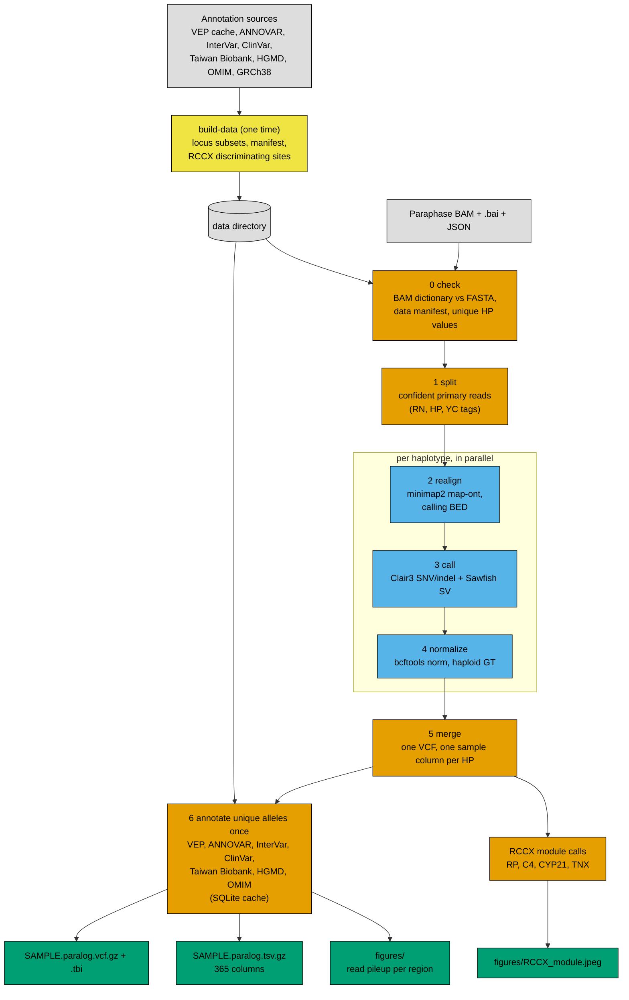
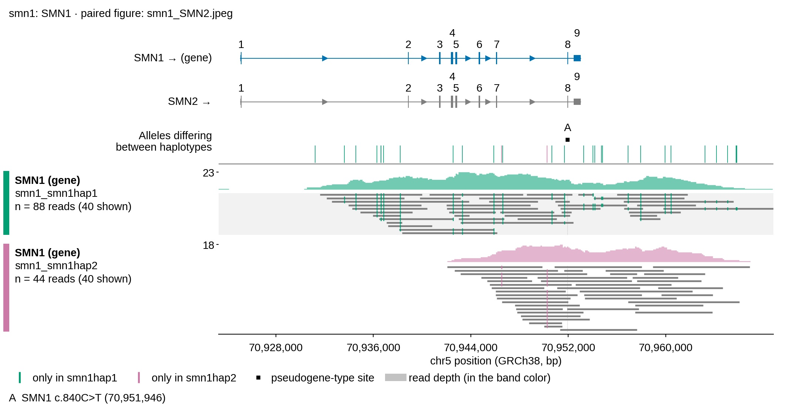
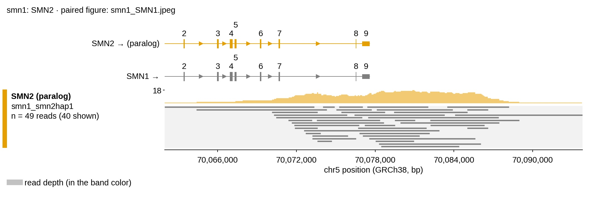
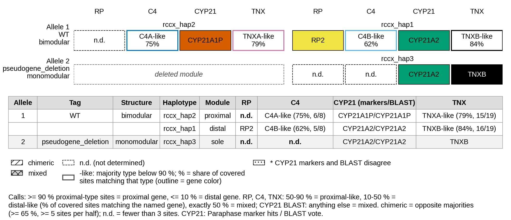

# paralog2viewer

[](https://github.com/oumarkme/paralog2viewer/pkgs/container/paralog2viewer)
[](https://www.gnu.org/licenses/gpl-3.0.html)
[](https://github.com/oumarkme/paralog2viewer/pkgs/container/paralog2viewer)
[](https://www.python.org/)
[](https://www.ncbi.nlm.nih.gov/grc/human)

Per-haplotype variant calls, annotation, and read-pileup figures for paralogous genes, starting from an Oxford Nanopore (ONT) Paraphase result.

Version 0.9.0 (pre-release). License GPL-3.0-or-later. Research use only, not a clinical diagnostic.

For each sample you get one annotated variant call format (VCF) file, one 365-column MViewer-format table, and one figure per gene region. A figure shows every read of a region as one row, grouped by haplotype (`HP` tag). Colored dots mark alleles that some haplotypes carry and others do not. White diamonds mark ClinVar or InterVar Pathogenic and Likely pathogenic alleles. Black squares mark pseudogene-type alleles from a curated table. For the RCCX region (RP-C4-CYP21-TNX modules), a second figure shows the module structure and the gene-conversion call per haplotype.

## What it does

Input: an existing Paraphase BAM, its `.bai` index, and its JSON. Paraphase is not rerun.



Gray: inputs and data. Yellow: one-time setup. Orange: steps run once per sample. Blue: steps run for every haplotype in parallel. Green: published outputs.

In the merged VCF `GT` is `1` when the haplotype carries the allele, `0` when its reads cover the site and show the reference, and `.` when its reads do not cover the site.

## Example figures

The figures below come from an ONT run of the public Genome in a Bottle reference sample HG002, processed with `--sample HG002`.

**SMN1 and SMN2.** Paraphase assigns each haplotype to SMN1 or SMN2, and each copy is drawn at its own locus, so the region gives two figures. From top to bottom, each figure shows the gene models with numbered exons, the alleles that differ between the haplotypes shown, and one band per haplotype. A band starts with the haplotype's gene and role (gene, paralog, or pseudogene). Below that come its read depth and up to 40 of its reads, with a tick on each read at every allele it carries. Lettered sites are named in the key below the axis; site A is SMN1 c.840C>T, the base that tells SMN1 from SMN2.





**RCCX module.** Each RCCX haplotype gets one box per gene (RP, C4, CYP21, TNX), with the module structure per allele, as described in [RCCX notes](#rccx-notes). In HG002, allele 1 is bimodular and allele 2 is monomodular. These calls are research output and have not been checked against published HG002 assemblies.



## Quick start

Requirements: Apptainer (or Docker), a GRCh38 FASTA with `.fai` and `.dict`, and about tens of GB of disk for the data directory.

The image holds software only (Clair3, Sawfish, minimap2, samtools, bcftools, VEP, BLAST). You obtain the model and the databases yourself: the Clair3 model (step 2), ANNOVAR (with its `humandb`), InterVar (with `intervardb`), and the profile tables (ClinVar, Taiwan Biobank, HGMD, OMIM genemap2, and the small tables PanelList, DefaultTranscript, Comments, Methylated). Mount the model at `/opt/clair3_model`, ANNOVAR at `/opt/annovar` and InterVar at `/opt/intervar` inside the container.

**1. Pull the image.** The image is public on the GitHub Container Registry (GHCR), so no account or token is needed. It is built for linux/amd64.

```bash
# Apptainer (HPC): converts the image to one .sif file
apptainer pull paralog2viewer.sif docker://ghcr.io/oumarkme/paralog2viewer:0.9.0

# Docker
docker pull ghcr.io/oumarkme/paralog2viewer:0.9.0
```

The examples below use Apptainer. With Docker, replace `apptainer exec -B a:b paralog2viewer.sif` by `docker run --rm -u "$(id -u):$(id -g)" -v a:b ghcr.io/oumarkme/paralog2viewer:0.9.0`, with one `-v` per mount.

**2. Download the Clair3 model (one time).** Calling uses the Clair3 ONT model `r1041_e82_400bps_sup_v520` (20 MB, two files). The model is licensed by Oxford Nanopore for research purposes only, so it is not in the image. Get it from the Clair3 authors' server, or copy it out of the official Clair3 image if that server is slow or unreachable. Both give the same files.

```bash
mkdir clair3_model && cd clair3_model

# Option A: the Clair3 authors' server (HKU)
url=https://www.bio8.cs.hku.hk/clair3/clair3_models_rerio_pytorch/r1041_e82_400bps_sup_v520
curl -fL -O "$url/pileup.pt" -O "$url/full_alignment.pt"

# Option B: the official Clair3 image on Docker Hub
apptainer exec docker://hkubal/clair3:v2.0.3 \
  cp /opt/models/r1041_e82_400bps_sup_v520/pileup.pt \
     /opt/models/r1041_e82_400bps_sup_v520/full_alignment.pt .

# Check the files (both lines must say OK)
sha256sum -c - <<'SUMS'
ec73e7fd3d955d8d64efbab29ba81f45c6129774a6c18beecc67c5829611fb4b  pileup.pt
3d45d34401613df5c4dcd31f3c444e13338a5cb0c8beb395d4f6ab71682f25d3  full_alignment.pt
SUMS
```

With Docker, Option B is `docker run --rm -v "$PWD":/out hkubal/clair3:v2.0.3 cp /opt/models/r1041_e82_400bps_sup_v520/pileup.pt /opt/models/r1041_e82_400bps_sup_v520/full_alignment.pt /out/`. A run stops at the start if the model is missing, and logs a warning if the files differ from these checksums.

**3. Build the data directory (one time).** `build-data` subsets every annotation source to the Paraphase loci plus padding (default 50 kb), rebuilds the indexes, precomputes RCCX discriminating sites, and writes `manifest.json` with checksums. The first build produced roughly 30 GB.

```bash
apptainer exec \
  -B /path/to/annovar:/opt/annovar,/path/to/intervar:/opt/intervar \
  -B /path/to/sources,/path/to/data \
  paralog2viewer.sif paralog2viewer build-data \
    --out /path/to/data \
    --reference /path/to/GRCh38.fa \
    --vep-cache /path/to/vep_cache \
    --annovar-db /path/to/annovar/humandb \
    --intervar-db /path/to/intervar/intervardb \
    --mviewer-profile /path/to/mviewer_profile \
    --regions /path/to/sample.paraphase.json \
    --threads 8
```

`--regions` takes one BED file or one or more Paraphase JSON files. The VEP cache root must contain `homo_sapiens_merged/` and `plugins/` (VEP plugin code, `alphamissense/`, `maxentscan/`).

**4. Run a sample.**

```bash
apptainer exec \
  -B /path/to/clair3_model:/opt/clair3_model \
  -B /path/to/annovar:/opt/annovar,/path/to/intervar:/opt/intervar \
  -B /path/to/input,/path/to/data,/path/to/results \
  paralog2viewer.sif paralog2viewer run \
    --bam /path/to/input/SAMPLE.paraphase.bam \
    --data /path/to/data \
    --outdir /path/to/results
```

Use `--dry-run` first to check inputs and print the planned steps. `paralog2viewer check --data /path/to/data` verifies the data directory against its manifest (`--quick` compares sizes only).

## Outputs

Written to `<outdir>/<SAMPLE_ID>/`:

| File | Content |
|---|---|
| `{SAMPLE_ID}.paralog.vcf.gz`, `.tbi` | Merged, annotated VCF, one sample column per `HP` value |
| `{SAMPLE_ID}.paralog.tsv.gz` | 365-column MViewer-format table |
| `figures/` | Read-pileup JPEG per region (`<region>.jpeg`), or one per locus named `<region>_<SYMBOL>.jpeg` (for example `pms2_PMS2.jpeg`, `pms2_PMS2CL.jpeg`) when a region has haplotypes projected to different loci; RCCX module figure |
| `timings.tsv` | Wall time, CPU time, and peak memory per step |

`--format vcf,mviewer` (default) writes both. `--format vcf` or `--format mviewer` writes one. Annotation runs in every case; a single-format run skips only the file writing. `--no-figures` skips plotting.

`SAMPLE_ID` is the BAM file name without `.paraphase.bam`. The BAM must end in `.paraphase.bam` unless you pass `--sample`.

## Options of `run`

| Option | Default | Meaning |
|---|---|---|
| `--bam` | required | Paraphase BAM (adjacent `.bai` and `.json` required) |
| `--data` | `$PARALOG2VIEWER_DATA` | Data directory from `build-data` |
| `--reference` | copy in the data directory | GRCh38 FASTA with `.fai` and `.dict` |
| `--outdir` | `results` | Output directory |
| `--sample` | from BAM name | Sample ID |
| `--tmp` | none | Scratch directory. The tool makes its own subdirectory, uses only that, and removes it after a successful run. Without `--tmp`, task files stay in `./work/<sample>` |
| `--work-dir` | none | Reuse this work directory to resume a run (never deleted) |
| `--resume`, `--no-resume` | resume on | Skip steps with a valid done-marker |
| `--cache` | `<data>/annotation_cache.sqlite` | Annotation cache, keyed by allele and data manifest checksum |
| `--format` | `vcf,mviewer` | Comma list of output formats |
| `--figures`, `--no-figures` | figures on | Draw figures |
| `--vcf-annotation` | `default` | `full` also adds selected ANNOVAR fields to the VCF |
| `--pseudogene-tsv` | table shipped with the package | Pseudogene allele table |
| `--threads` | all CPUs the process may use | Maximum CPU threads. The tool splits them across steps itself. To pin CPUs, start the tool with `taskset -c 0-19 paralog2viewer run ...` |
| `--memory` | 80% of available memory | Maximum memory in GB (cgroup limit or `MemAvailable`, whichever is smaller) |
| `--verify-checksums` | sizes only | Hash every data file at start (slow) |
| `--dry-run` | off | Check inputs, print the planned steps, exit |

## Things to know about the table

- The columns are the standard 365 MViewer columns, in the order of `resources/mviewer_header.tsv`. The file starts with two comment lines (`#keywords=`, `#sex=`).
- One row per allele and per haplotype with GT 1. `Genotype` is the exact `HP` tag value.
- 58 columns are always empty: legacy columns, `Methylated loci`, CentoMD, PharmGKB, MaxEntScan, SpliceAI, family genotypes, Author Interpretation, Comment, Het_Percent, ExpansionHunter, AutoMap, `am_class`, `am_pathogenicity`.
- `Severity Score` is empty because its formula is not decoded.
- Nine columns are rebuilt by rule from VEP and `DefaultTranscript.tsv`: `Consequence`, `Gene`, `Variant`, `Type`, `Max Allele Freq`, `Transcript`, `Exon`, `Nucleotide` (HGVS c.), `AAChange` (HGVS p.).
- Transcript: a `DefaultTranscript.tsv` transcript is used whenever VEP reports one for the allele (its accession version is ignored). Otherwise the tool falls back to the MANE Select transcript, then the canonical RefSeq transcript, then any canonical transcript, then the first VEP transcript row.
- Symbolic and breakend alleles (Sawfish) keep their true ALT, coordinates, and VEP consequence. ANNOVAR-derived columns are empty for them.
- `Otherinfo1-13` come from the haplotype's own call. The `ID` field is `.`.
- The VCF carries the full VEP `CSQ` field and INFO tags `INTERVAR` and `CLNSIG`. It never contains HGMD or Taiwan Biobank values, because those data are licensed or restricted.
- Not verified: the HGMD, ClinVar, and Taiwan Biobank join rules were inferred from the output values of two earlier validation tables (9,901 rows), not from the vendors' documentation.

## RCCX notes

- Variants come from the same Clair3 and Sawfish path as every other gene.
- The module call (C4A/C4B, TNXA/TNXB, WHR1/WHR1B by a vote over precomputed BLAST sites; CYP21A2 versus CYP21A1P from Paraphase marker hits) depends on Paraphase phasing. If Paraphase phasing failed, alleles show as `unassigned`.
- The calls have had no clinical-geneticist review on a known CYP21A2 chimera. Treat them as research output.

## Resources and speed

- Give the tool the CPUs and memory it may use (`--threads`, `--memory`); it decides the rest. On a shared machine, set both below the machine total.
- How the budget is used: each haplotype's Clair3 and Sawfish calls run on one thread, so up to `--threads` haplotypes run at once, largest first. Annotation then uses the whole budget, with VEP and ANNOVAR/InterVar side by side. RCCX calls run during annotation, and figures use one worker per region.
- With `--threads 40`, a full run of one validation sample (83 to 107 haplotypes) took 128 to 138 s on our server, down from 456 to 568 s before calling ran one thread per haplotype. The previous Nextflow pipeline took about 33 minutes on the same sample.
- `--tmp` should point to a fast local disk. I have not benchmarked network storage against local disk for this tool.
- A finished step leaves a done-marker keyed by an input hash. A rerun with the same `--work-dir` skips it. The annotation cache also speeds up later samples.

## Troubleshooting

| Message or symptom | Action |
|---|---|
| Data manifest mismatch (build, tool versions, checksum) | Rebuild with `build-data`, or run `check --data DIR` to see which file differs. |
| Calling regions lie outside the data subsets | The data directory was built from other loci. Rebuild with `--regions` that include this sample's JSON, or a larger `--padding`. |
| Reference or dictionary missing | Give `--reference` a FASTA with `.fai` and `.dict` next to it. Its contigs must match the Paraphase BAM header. |
| Run failed | The work directory is kept. Start again with `--work-dir <same directory>` to resume. |
| Clair3 model file not found | The tool looks for `/opt/clair3_model/pileup.pt` and `full_alignment.pt`. Download the model (Quick start, step 2) and add `-B /path/to/clair3_model:/opt/clair3_model`. |
| ANNOVAR or InterVar not found | The tool looks for `/opt/annovar/table_annovar.pl` and `/opt/intervar/Intervar.py`. Check the `-B` mounts. |
| Input not accepted | The BAM must end in `.paraphase.bam` (or pass `--sample`) and have `.bai` and `.json` next to it. |

## Development

```bash
pip install -e '.[dev]'
pytest -q tests
ruff check && ruff format --check
```

The version lives in the `VERSION` file only. GitHub Actions (`.github/workflows/ci.yml`) builds the test image from `docker/Dockerfile`, runs ruff and pytest inside it, and on a push to `main` or a `v*` tag pushes the runtime image to `ghcr.io/oumarkme/paralog2viewer`. A tag must equal `v` plus the content of `VERSION`. GHCR creates a new package as private. After the first push, the owner sets it to public once (package page, Package settings, Change visibility); the repository itself can stay private.

## License and third-party tools

paralog2viewer is GPL-3.0-or-later (see `LICENSE`). Third-party tools keep their own licenses. The table lists what web lookups on 2026-11-13 and 2026-11-16 found; "not verified" means no license text could be fetched, so check upstream before redistributing. The image contains Clair3, Sawfish, minimap2, samtools, bcftools, longphase, VEP and BLAST+; it does not contain the Clair3 model, Paraphase, ANNOVAR, InterVar or any annotation data. The Clair3 ONT model, which you download yourself, derives from Oxford Nanopore's Rerio models and is licensed for research purposes only.

| Tool | Role | License | Citation |
|---|---|---|---|
| [Paraphase](https://github.com/PacificBiosciences/paraphase) | Haplotype phasing (input) | PacBio Software License Agreement (not OSI) | Chen et al., Nat Commun 2025, doi:10.1038/s41467-025-57505-2 |
| [Clair3](https://github.com/HKU-BAL/Clair3) | SNV/indel calling | BSD-3-Clause (LICENSE.md) | Journal reference not verified (preprint doi:10.1101/2021.12.29.474431) |
| Clair3 ONT model r1041_e82_400bps_sup_v520 | Clair3 model (from [Rerio](https://github.com/nanoporetech/rerio)) | Oxford Nanopore Public License 1.0, research purposes only | none |
| [Sawfish](https://github.com/PacificBiosciences/sawfish) | SV calling | PacBio Software License Agreement (not OSI; binary redistribution allowed) | Saunders et al., Bioinformatics 2025, doi:10.1093/bioinformatics/btaf136 |
| [longphase](https://github.com/twolinin/longphase) | Installed with Clair3 | GPL-3.0 | not checked |
| [minimap2](https://github.com/lh3/minimap2) | Alignment | MIT | Li, Bioinformatics 2018, doi:10.1093/bioinformatics/bty191 |
| [samtools, bcftools](https://github.com/samtools) | BAM and VCF tools | MIT (from a citation abstract) | Danecek et al., GigaScience 2021, doi:10.1093/gigascience/giab008 |
| [VEP](https://www.ensembl.org/info/docs/tools/vep/) | Consequence annotation | Apache-2.0 | McLaren et al., Genome Biol 2016, doi:10.1186/s13059-016-0974-4 |
| [ANNOVAR](https://annovar.openbioinformatics.org/) | Annotation (user-supplied) | not verified; check the ANNOVAR site | Wang et al., Nucleic Acids Res 2010;38:e164 |
| [InterVar](https://github.com/WGLab/InterVar) | ACMG-style classification (user-supplied) | Free for non-commercial use | Li and Wang, Am J Hum Genet 2017, doi:10.1016/j.ajhg.2017.01.004 |
| BLAST+ | RCCX site design | Public domain (NCBI) | Camacho et al., BMC Bioinformatics 2009, doi:10.1186/1471-2105-10-421 |

Citation: no paper describes paralog2viewer yet. If you publish results, cite the tools above. PubMed IDs were not checked.

History: v0.9.0 replaces an earlier Nextflow pipeline with this single Python tool.

## Author

Jen-Hsiang Ou, Ph.D., Department of Medical Genetics, National Taiwan University Hospital.
